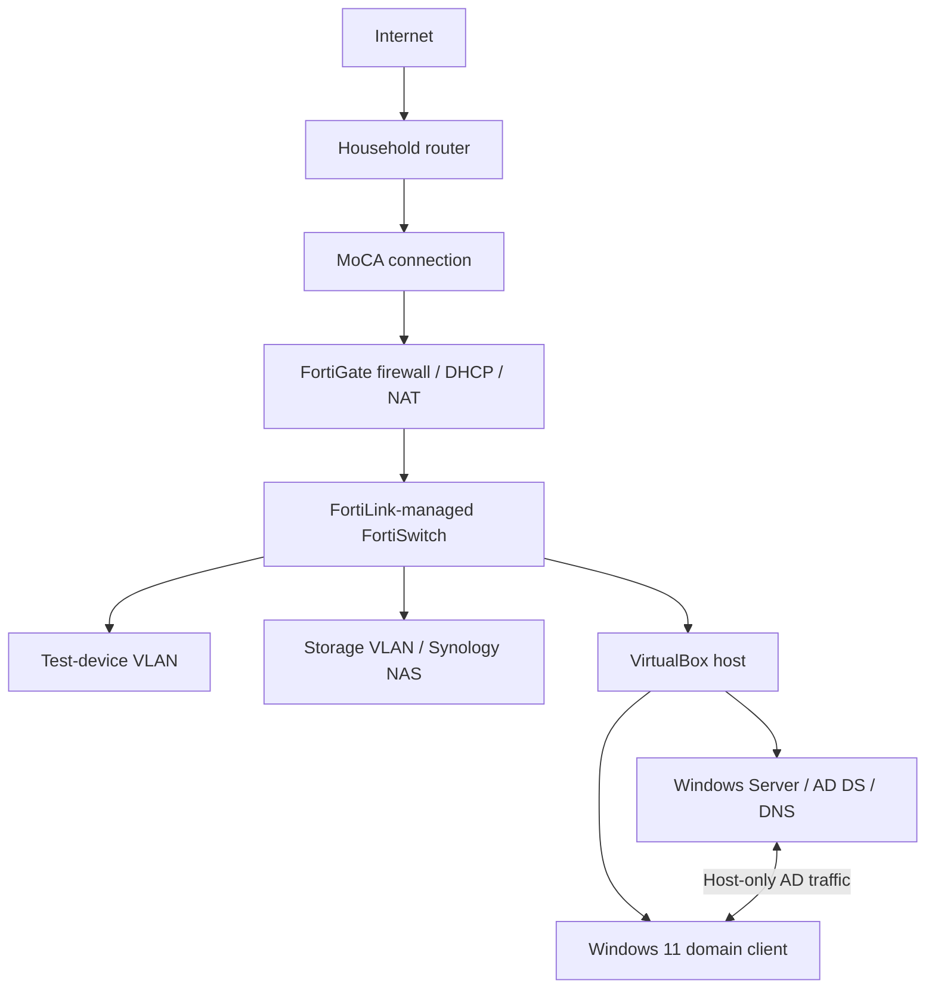

# IT Infrastructure & Security HomeLab

**Self-directed, AI-guided technical lab** using personally owned equipment to practice networking, Windows administration, access controls, troubleshooting, and defensive security testing.

I built a Fortinet-based segmented lab network and a separate Windows Server Active Directory environment. The work includes verified firewall allow/deny behavior, domain authentication, delegated access, file-share permissions, and a controlled Linux SSH attack → hardening → detection → retest cycle. These are **learning exercises, not professional production deployments**.

## Verified project work

| Area | What was built and tested | Status |
| --- | --- | --- |
| **Fortinet network segmentation** | FortiGate 60F and FortiLink-managed FortiSwitch 108F-POE; test-device and storage VLANs, DHCP, outbound NAT, and a limited storage-management policy. Cross-VLAN traffic was blocked before the relevant allow policy and worked afterward. | Completed lab scope; traffic-log screenshots pending |
| **Windows Active Directory** | Windows Server 2025 AD DS and DNS, department OUs, fictional users, five security groups, and a Windows 11 domain-joined client. Domain sign-in verified. | Core lab completed; department drive mapping pending |
| **Policy and access controls** | Applied a 15-minute workstation lock GPO, delegated help desk password reset and forced-change rights, and tested department-specific NTFS/SMB share access with allow/deny checks. | Verified for the specific controls tested |
| **Network/DNS troubleshooting** | Resolved a stale client DNS configuration and an AD client's incorrect DNS resolver; validated resolution after the fixes. | Two documented cases |
| **Linux SSH security test** | On an owned Ubuntu target, tested an intentionally weak SSH credential, changed the password and SSH settings, enabled fail2ban, and reran the same test. No password was recovered on retest; fail2ban recorded a ban. | Attack → harden → detect → retest completed, October 11, 2026 |
| **NAS and lab foundation** | Deployed Synology DSM on a storage VLAN. SMART checks exposed unsuitable disks, so the storage pool/RAID build is intentionally postponed. | NAS functional; storage pool deferred |
| **Virtualization** | VirtualBox Windows Server and Windows 11 VMs using NAT and host-only networking; resolved a VM graphics issue. | Supporting environment |

## Architecture — conceptual, sanitized

**Design trade-off:** the domain VMs communicate on a VirtualBox host-only network, so their domain traffic does **not** traverse the FortiGate. The household router remains outside the lab's configuration scope. The NAS storage pool is not built because drive-health checks failed.

## Documentation and evidence

- [Authorized SSH attack, hardening, detection & retest](docs/ssh-hardening-and-retest.md) — the October 11, 2026 completed attack-and-defend case study, including a real SSH service-startup fault and honest network-isolation limitation.
- [Active Directory](docs/active-directory.md) — domain build, role-based access, verification, and remaining tasks.
- [Networking](docs/networking.md) — Fortinet VLAN, DHCP, NAT, and firewall policy scope.
- [Troubleshooting](docs/troubleshooting.md) — two DNS incidents and the diagnosis/fix methodology.
- [Virtualization](docs/virtualization.md) — design and VM verification.
- [Architecture](docs/architecture.md) — why physical networking and AD virtualization are separated.
- [Cybersecurity lab](docs/cybersecurity-lab.md) — authorization boundaries and defensive testing.
- [Architecture diagrams](diagrams/network-topology.md) and [AD diagram](diagrams/active-directory-structure.md) — conceptual topology and directory relationships.

The HomeLab technical-evidence source is maintained separately. Public pages are curated from verified handoffs; **internal evidence handoff documents, credentials, private host/account names, and sensitive configuration are not published**. No sanitized screenshots have been uploaded to this repository for the latest verified milestones.

## Limits and unfinished work

- **Target network isolation is not yet verified.** Traffic from the main lab subnet reached the Ubuntu test target. Do not infer that the intended VLAN-only firewall policy exists.
- Group Policy **drive mapping** is not complete. Only the 15-minute lock baseline is verified.
- Aruba/Cisco switch configuration and multi-vendor trunking remain planned; racking hardware is not configuration.
- The AD exercises, firewall work, and security testing were conducted with significant step-by-step AI assistance. They demonstrate hands-on **practice**, not independent mastery, penetration-testing experience, or enterprise operations ownership.
- This portfolio is updated as evidence is validated. No uptime, enterprise users, production security, or incident-response outcomes are claimed.

**Last evidence review:** October 11, 2026.
