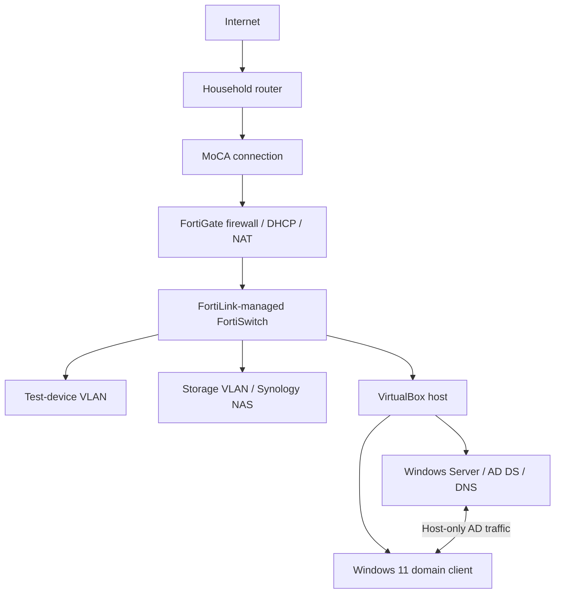
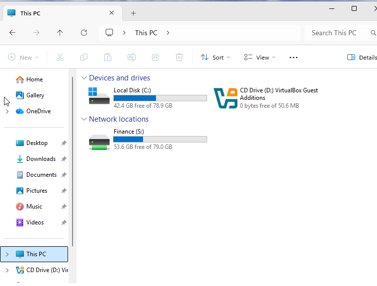

# IT Infrastructure & Security HomeLab

**Self-directed technical HomeLab** using personally owned equipment to practice networking, Windows administration, access controls, troubleshooting, and defensive security testing.

I built a Fortinet-based segmented lab network and a separate Windows Server Active Directory environment. The work includes verified firewall allow/deny behavior, domain authentication, delegated access, file-share permissions, and a controlled Linux SSH attack → hardening → detection → retest cycle.

## Verified project work

| Area | What was built and tested | Status |
| --- | --- | --- |
| **Fortinet network segmentation** | FortiGate 60F and FortiLink-managed FortiSwitch 108F-POE; test-device and storage VLANs, DHCP, outbound NAT, and a limited storage-management policy. Cross-VLAN traffic was blocked before the relevant allow policy and worked afterward. | Completed lab scope; traffic-log screenshots pending |
| **Windows Active Directory** | Windows Server 2025 AD DS and DNS, department OUs, fictional users, five security groups, and a Windows 11 domain-joined client. Domain sign-in verified. | Core lab completed; newer GPO screenshots need technical-owner ledger reconciliation |
| **Policy and access controls** | Applied a 15-minute workstation lock GPO, delegated help desk password reset and forced-change rights, and tested department-specific NTFS/SMB share access with allow/deny checks. | Verified for the specific controls tested |
| **Department drive mapping (new evidence)** | Screenshots curated October 18 show four configured Group Policy Drive Maps entries, a Finance `S:` drive visible in File Explorer, and an access-denied cross-department folder check. | Historical screenshot observations; complete user-by-user validation and technical ledger update are not claimed here |
| **Network/DNS troubleshooting** | Resolved a stale client DNS configuration and an AD client's incorrect DNS resolver; validated resolution after the fixes. | Two documented cases |
| **Linux SSH security test** | On an owned Ubuntu target, tested an intentionally weak SSH credential, changed the password and SSH settings, enabled fail2ban, and reran the same test. No password was recovered on retest; fail2ban recorded a ban. | Attack → harden → detect → retest completed, October 11, 2026 |
| **NAS and lab foundation** | Deployed Synology DSM on a storage VLAN. SMART checks exposed unsuitable disks, so the storage pool/RAID build is intentionally postponed. | NAS functional; storage pool deferred |
| **Virtualization** | VirtualBox Windows Server and Windows 11 VMs using NAT and host-only networking; resolved a VM graphics issue. | Supporting environment |

## Architecture — conceptual, sanitized

**Design trade-off:** the domain VMs communicate on a VirtualBox host-only network, so their domain traffic does **not** traverse the FortiGate. The household router remains outside the lab's configuration scope. The NAS storage pool is not built because drive-health checks failed.

## Direct screenshot evidence — limited scope

*Figure: A Finance `S:` drive appears in a Windows test client's File Explorer. This image documents one observed mapped drive, **not** end-to-end validation of every department, underlying item-level targeting, or a new live test. Other screenshots remain private pending individual sanitation. The screenshot was curated in October 2026; GitHub review did not rerun the lab.*

## Documentation and evidence

- [Authorized SSH attack, hardening, detection & retest](docs/ssh-hardening-and-retest.md) — the October 11, 2026 completed attack-and-defend case study, including an SSH service-startup fault and the remaining network-isolation follow-up.
- [Active Directory](docs/active-directory.md) — domain build, role-based access, verification, and remaining tasks.
- [Networking](docs/networking.md) — Fortinet VLAN, DHCP, NAT, and firewall policy scope.
- [Troubleshooting](docs/troubleshooting.md) — two DNS incidents and the diagnosis/fix methodology.
- [Virtualization](docs/virtualization.md) — design and VM verification.
- [Architecture](docs/architecture.md) — why physical networking and AD virtualization are separated.
- [Cybersecurity lab](docs/cybersecurity-lab.md) — authorization boundaries and defensive testing.
- [Architecture diagrams](diagrams/network-topology.md) and [AD diagram](diagrams/active-directory-structure.md) — conceptual topology and directory relationships.

Credentials, private host/account names, and sensitive configuration are excluded from public documentation. Sanitized screenshots will be added where they improve the case studies.

## Current follow-ups

- **Target network isolation:** attack traffic reached the Ubuntu target from the main lab subnet, so the intended VLAN-only firewall path still needs to be implemented and verified.
- **Group Policy drive mapping:** newer screenshots show configuration and example client behavior, but the October 8 authoritative technical ledger still calls this a next step. The HomeLab technical owner needs to reconcile the evidence and confirm the final per-user scope.
- **Aruba/Cisco switching:** switch configuration and multi-vendor trunking remain planned.
- **Portfolio evidence:** add polished, sanitized screenshots for the strongest milestones.

**Technical test documentation:** through October 11, 2026. **Additional screenshot review:** October 18, 2026. No new physical/virtual lab test was rerun during this GitHub documentation review.
