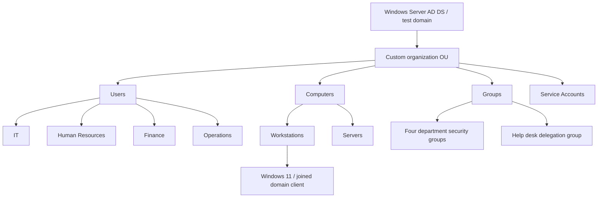

# Active Directory — Verified Logical Structure

**Scope:** self-directed Windows Server 2025 lab. Simplified diagram, with fictional example identities omitted from public view.

The four fictional user accounts were organized by department. Group-based NTFS/SMB share access was tested from the client with both allowed and denied results. A help desk group had scoped password-reset/force-change rights, verified with a test user. The **Workstation Baseline** GPO's 15-minute lock was applied and verified.

**Not yet complete:** Group Policy drive mapping, an independent skill check, and a sanitized screenshot evidence set.

The AD host-only virtual network is separate from the Fortinet-routed physical network.

See [the AD evidence summary](../docs/active-directory.md).
