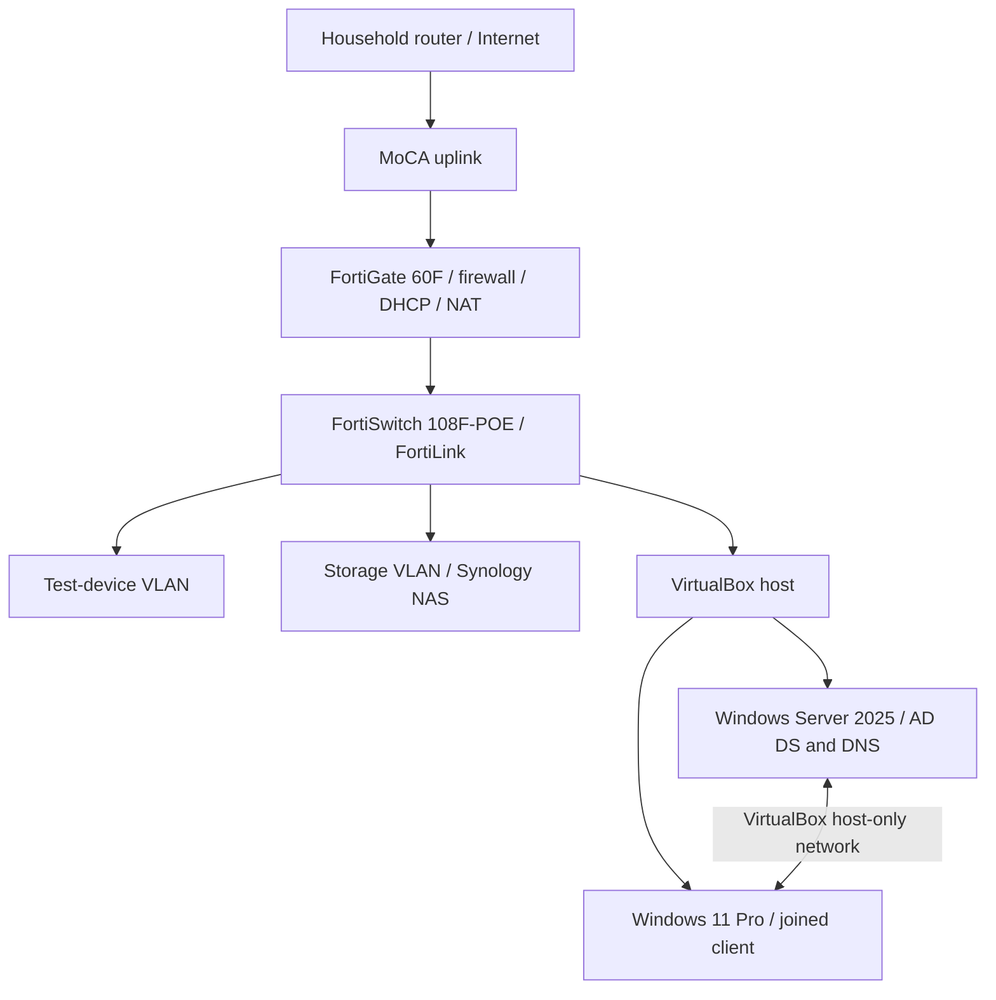

# HomeLab Network Topology — Sanitized Overview

**Based on verified HomeLab evidence through October 11, 2026.** The diagram shows technology relationships, not administrative endpoints or precise device addressing.

**Verified:** the test-device and storage VLANs exist; scoped storage-management access worked after a firewall policy was added. A lab-client outbound path uses NAT. The AD environment is separate and its traffic does **not** traverse the FortiGate.

**Not shown as complete:** Aruba/Cisco switch configuration, multi-vendor trunking, a NAS storage pool/RAID, and network isolation of the Ubuntu SSH test target.

See [networking](../docs/networking.md) and [architecture](../docs/architecture.md).
