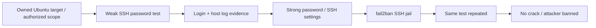

# HomeLab Security Testing — Verified and Planned

Security tests are conducted only against systems owned and prepared for the lab. **The diagram below reflects the specific SSH attack-and-defend cycle verified October 11, 2026, not a completed general penetration-testing methodology.**

## What the evidence supports

- Original weak-password test succeeded on the lab-owned Ubuntu target, including SSH access and root escalation.
- After password and SSH configuration changes, the same test did not recover the password.
- fail2ban recorded a ban, and the attacker-side test stalled.
- A service-startup problem involving a missing `/run/sshd` directory was resolved and SSH-on-boot was verified.

## What it does not support

- Claiming a professional or independent penetration test.
- Claiming that network segmentation isolates the target: the test traffic reached the target from the main lab subnet. Intended VLAN-only access remains open.
- Claiming broader vulnerability assessment, web application testing, incident response, or a full hardening baseline.

[Full verified SSH case study](../docs/ssh-hardening-and-retest.md) · [Authorization rules](../docs/cybersecurity-lab.md)
