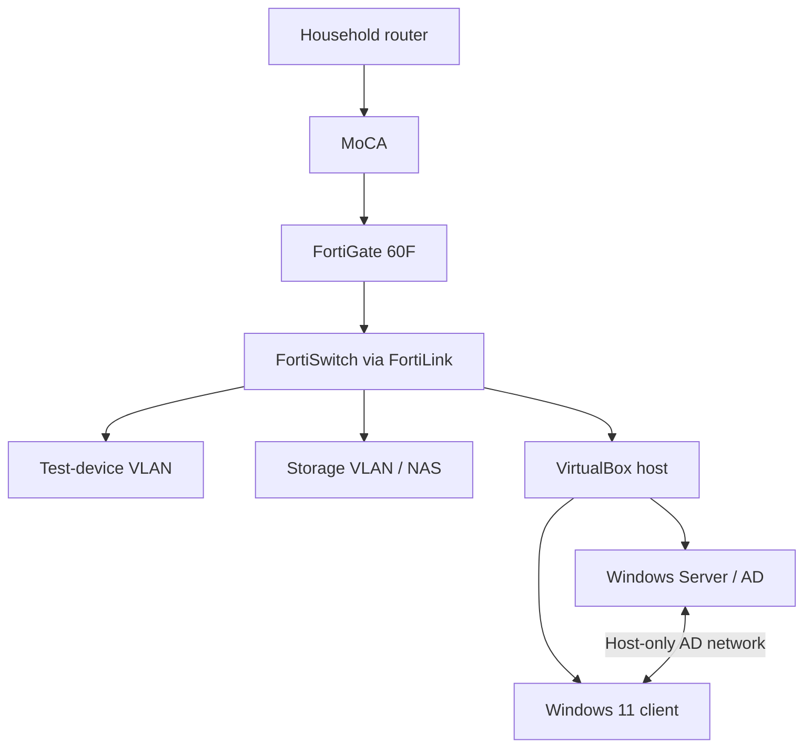

# HomeLab Architecture — Verified Design

**Scope:** self-directed learning lab using owned equipment; not professional or production infrastructure. Current evidence through October 11, 2026.

## Why the lab is split

A household router provides the upstream connection through a MoCA link. The downstream **FortiGate 60F** handles the lab's firewall, DHCP, NAT, and VLAN gateways. A **FortiLink-managed FortiSwitch 108F-POE** connects physical equipment.

Two lab segments are configured: a test-device VLAN and a storage VLAN for the Synology NAS. A scoped policy permits specified NAS management access across segments. The NAS is reachable; no RAID/storage pool has been built because the available disks failed drive-health checks.

A separate **VirtualBox** setup hosts Windows Server 2025 (domain controller, AD DS, DNS) and a Windows 11 Pro domain client. VirtualBox NAT provides Internet access while a gateway-less host-only adapter carries AD traffic. This keeps directory testing stable but means **AD traffic does not cross the FortiGate**.

## Security-testing boundary

An owned Ubuntu target was tested from Kali for an intentionally weak SSH password. The password was changed and SSH/fail2ban controls were validated by retesting. **Network isolation of this target remains incomplete**: the attack path from the main lab network still worked. See [the evidence-based case study](ssh-hardening-and-retest.md).

## Hardware and status

| Component | Verified status |
| --- | --- |
| FortiGate, FortiSwitch, MoCA link | Working in the lab |
| Windows Server and Windows 11 VMs | Domain join and policy tests completed |
| Synology NAS | DSM reachable; disks unsuitable for storage pool |
| Older Dell Linux target | Ubuntu and SSH test/hardening completed |
| Aruba CX 6000 and Cisco Catalyst 9300 | Racked only; configuration untested |

This public overview omits private account names, MAC/serial identifiers, and device administration details. Configurations, private network inventory, and original technical evidence are retained outside the public portfolio.
